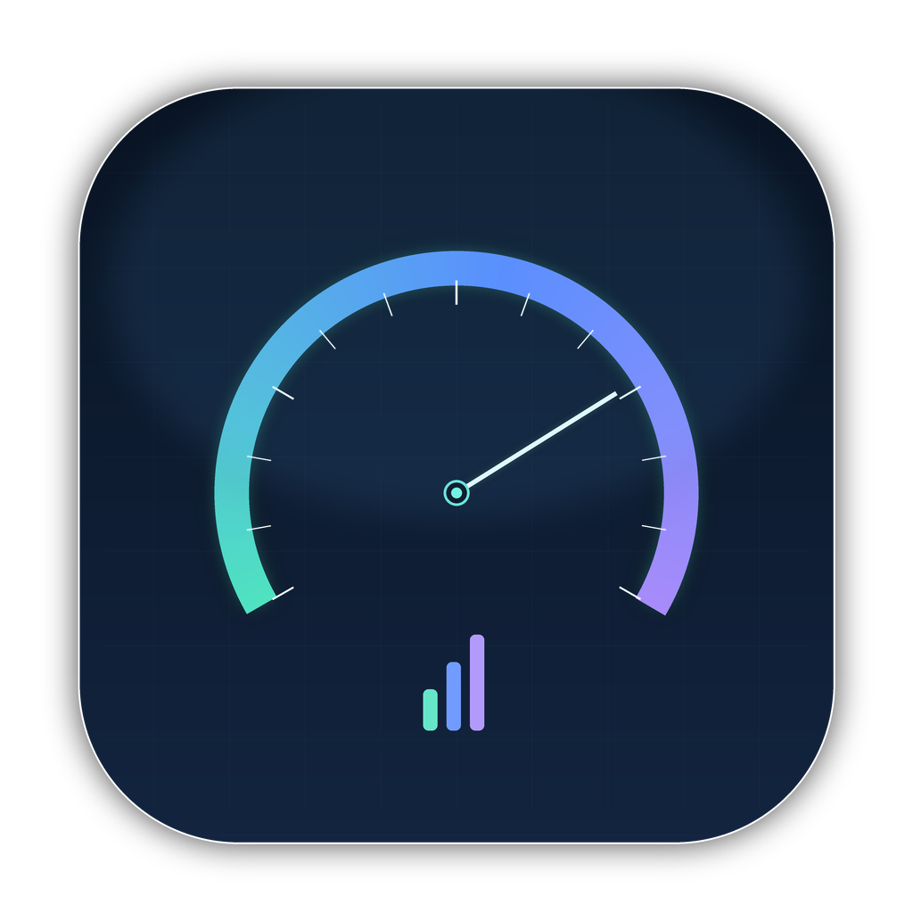
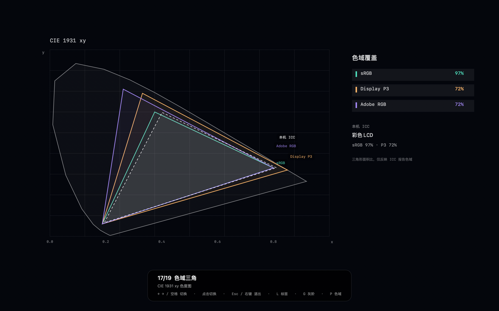

# MacPerf · Mac 性能测评

一款原生 macOS 性能测评小工具，把 **CPU 跑分、硬盘测速、内存带宽、屏幕检测** 和 **实时硬件监测** 放在同一个窗口里。界面为 SwiftUI + AppKit 实现，无第三方依赖、无需管理员权限、不联网。






## 功能

### 实时硬件监测（所有页面顶部常驻）

- **CPU 占用**：`host_processor_info` 读取每个核心的 tick，计算整机与逐核占用。
- **GPU 占用**：IOKit `IOAccelerator` 的 `Device Utilization %`。
- **内存**：`host_statistics64` 计算已用内存、内存压力与交换空间。
- **磁盘吞吐**：`IOBlockStorageDriver` 的累计读写字节数差分，显示实时 R/W。
- **温度**：AppleSMC 直读，覆盖 `Tp*` CPU、`Tg*` GPU、`TB0T` 电池传感器组，取组内最高值。
- **整机功耗**：优先使用 `AppleSmartBattery` 的 `PowerTelemetryData`（电池放电 / 系统负载），同时读取 SMC `PSTR` 作为参考；无电池的 Mac 自动退回 SMC。
- **其他**：热压状态、电池百分比、充电状态、运行时间、SMC 在线状态。

刷新频率 1 秒，历史曲线保留最近 90 秒。

### CPU 跑分

- 混合整数 xorshift、乘加、双精度除法和累加负载。
- 单核固定 2.4 秒，多核使用全部核心固定 4.0 秒。
- 输出：
  - 单核分数（Mops/s）
  - 多核分数（Mops/s）
  - 多核效率（多核吞吐 ÷（单核吞吐 × 线程数））
  - 测试耗时、峰值 CPU 占用、峰值温度、峰值功耗
- 测试期间实时绘制 CPU / 温度曲线。

### 硬盘测速

- 可选 256 MB / 512 MB / 1 GB / 2 GB 临时文件。
- 顺序写入（包含 `fsync` 落盘）、顺序读取（`F_NOCACHE` 绕过缓存）、2,000 次 4K 随机读取。
- 输出顺序写入 GB/s、顺序读取 GB/s、4K 随机读 IOPS。
- 测试文件写入系统临时目录，结束后自动删除，不会留在磁盘里。
- 实时显示测试期间的磁盘读 / 写吞吐曲线。

### 内存测速

- 可选 128 / 256 / 512 MB 工作集。
- 4 线程并行测试顺序读、顺序写、拷贝、Triad（`a + 3 × b`）带宽。
- 32 MB 工作集上的随机指针追逐，测试访问延迟。
- 输出 GB/s 和 ns，并实时显示内存占用与 CPU 曲线。

### 屏幕检测

- 19 张全屏测试图，全部由程序实时绘制：
  - 纯色：白、50% 灰、18% 灰、黑、红、绿、蓝、青、洋红、黄
  - 灰阶：21 级灰阶、近黑 11 级、RGB 渐变、色相扫描
  - 标准图：75% 彩条 + PLUGE
  - 色域：sRGB / Display P3 对比、CIE 1931 xy 色域三角
  - 均匀性：15 区白场网格、黑场网格
- 全屏窗口使用 **Display P3** 色彩空间，系统按当前显示器 ICC 做色彩转换。
- 自动读取显示器 ICC 的 `rXYZ / gXYZ / bXYZ`，计算 sRGB / P3 / Adobe RGB 三角面积覆盖率。
- 手动切换：
  - `←` / `→` / `空格`：上一张 / 下一张
  - `1`–`9`：跳到第 N 张
  - `G` 灰阶、`C` 彩条、`P` 色域对比、`T` 色域三角
  - `L` 显示 / 隐藏标签
  - 点击左 / 右半屏切换；`Esc` 或右键退出
- 支持多显示器选择，在副屏上全屏测试。

## 下载 / 直接运行

前往 [GitHub Releases](https://github.com/editwe/MacPerf/releases/latest) 下载 `MacPerf-1.0.zip`，解压后双击 `MacPerf.app` 即可。应用为 ad-hoc 签名，不需要安装任何运行时。

若从其他 Mac 拷贝后被 Gatekeeper 拦下，可右键选择“打开”，或执行：

```bash
xattr -dr com.apple.quarantine MacPerf.app
```

## 从源码构建

```bash
git clone https://github.com/editwe/MacPerf.git
cd MacPerf
./Scripts/build.sh
open MacPerf.app
```

### 构建环境

环境要求：macOS 14+、Xcode Command Line Tools（`swiftc` / `clang` / `iconutil`）。无需完整 Xcode。

构建脚本会：

1. 用 `clang` 编译只读 SMC 桥接层；
2. 用 `swiftc` 编译 SwiftUI / AppKit 界面；
3. 组装 `MacPerf.app`、复制图标和 `Info.plist`；
4. 使用 ad-hoc 签名。

## 自动化 URL（可选）

应用注册了 `macperf://` scheme，方便脚本或快捷指令直接打开页面 / 启动测试：

```bash
open 'macperf://overview'
open 'macperf://cpu'
open 'macperf://cpu?run=1'
open 'macperf://disk?run=1'
open 'macperf://memory?run=1'
open 'macperf://screen'
open 'macperf://screentest?pattern=graySteps'
open 'macperf://screentest?pattern=gamutTriangle'
open 'macperf://screentest?close=1'
```

## 指标说明与限制

- **温度是 SMC 原始传感器值**。不同工具可能取平均值、封装温度或某个特定 sensor，因此和其他软件显示的数字可能不同。本工具在 CPU 组 / GPU 组内取最高值，用于观察热点和热降频趋势。
- **功耗是系统级估算**。电池机型优先使用 `PowerTelemetryData`（充放电功率），电源供电时受充电功率影响；无电池机型退回 SMC `PSTR`。若需要校准到墙插功率，需要外接功率计。
- **跑分只适合本机前后对比**。不同架构、不同代际的 CPU 不能直接按 Mops/s 比较；硬盘成绩受文件系统、剩余空间、后台任务和温度影响；内存带宽受工作集、线程数和内存压力影响。
- 测试前建议：接通电源、关闭大型后台任务、关闭低电量模式，并在温度稳定后测试。
- 屏幕检测依赖当前显示器 ICC。ICC 报告的色域与实际面板色域可能不一致；色域三角图显示的是 **ICC 报告值**，不是分光光度计实测值。
- 本工具不收集、不上传任何数据，不请求网络权限，不修改系统设置。

## 目录结构

```text
MacPerfBench/
├── Sources/
│   ├── MacPerfApp.swift        # App 入口（单窗口）
│   ├── ContentView.swift       # 侧边栏 / 实时监测条 / 路由
│   ├── OverviewView.swift      # 概览
│   ├── CPUBenchView.swift      # CPU 页面
│   ├── DiskBenchView.swift     # 硬盘页面
│   ├── MemoryBenchView.swift   # 内存页面
│   ├── ScreenTestView.swift    # 屏幕检测页面
│   ├── ScreenTestWindow.swift  # 全屏 NSWindow + 图案绘制
│   ├── SystemMonitor.swift     # 实时监控采样
│   ├── HardwareInfo.swift      # 硬件 / 显示器 ICC 信息
│   ├── CPUBenchmark.swift      # CPU 引擎
│   ├── DiskBenchmark.swift     # 硬盘引擎
│   ├── MemoryBenchmark.swift   # 内存引擎
│   ├── SMCBridge.c             # AppleSMC 只读桥接
│   ├── Bridge.h
│   ├── Theme.swift
│   ├── Components.swift
│   ├── Models.swift
│   └── ViewStates.swift
├── Resources/
│   ├── Info.plist
│   ├── AppIcon.icns
│   └── AppIcon-1024.png
├── Screenshots/
├── Scripts/build.sh
├── LICENSE
├── .gitignore
└── README.md
```

## 版本

- 1.0
- 构建目标：`$(uname -m)-apple-macos14.0`（当前实机为 arm64）
- 已在 Apple A18 Pro / macOS 27 环境实机验证 CPU、硬盘、内存跑分和全部屏幕图案。
